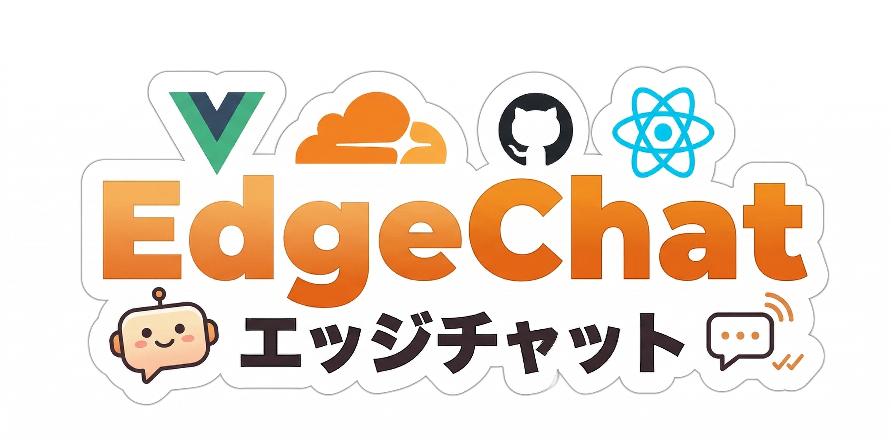

<div align="center">
  
</div>

[GitHub 仓库](https://github.com/cuixi1018/Xiliao-IM) · [项目文档](https://doc.chsm666.top/) · [开源协议（GPL v3 或更高版本）](https://www.gnu.org/licenses/gpl-3.0)

细聊（Xiliao）是一个部署在 Cloudflare 上的即时通讯系统，采用微信风格设计，提供细聊号、好友系统、朋友圈、群聊、私信、语音消息、实时消息、文件传输和管理员后台，目标是打造一套"小而美"的可落地站内 IM。

本项目采用 `GPL-3.0-or-later` 协议，详见 [LICENSE](LICENSE)。

## 功能特性

### 微信风格社交
- **细聊号**：每个用户注册后自动生成全局唯一的细聊号（如 `cuixi#8F3A`），可用于登录、加好友、建群
- **好友系统**：按细聊号搜索添加好友、好友申请与验证、删除好友
- **朋友圈**：发布图文动态、点赞、评论与回复，仅好友可见
- **黑名单**：拉黑用户后互相不可见、不可发消息
- **建群规则**：群主必须先添加对方为好友才能将其拉入群聊
- **退群 / 清空聊天记录**：成员可主动退群，可清空自己看到的聊天记录（不影响对方）

### 消息与沟通
- 支持公开群组、私有群组与私信会话，实时消息推送
- 表情面板、语音消息录制与播放、历史消息分页、消息检索、文件发送
- 折叠群聊：将不常用的群聊折叠收纳
- 管理员可查看任意群组和私信消息

### 注册与后台
- 内置"熙熙账号" OAuth 自助注册（可通过后台开关控制开放），注册后自动生成细聊号
- 支持邀请链接注册、管理员创建用户
- 后台包含用户管理、消息查看、网站设置等子页面
- 支持定时硬删除过期消息

## 技术栈

- 前端：Vue 3、Vue Router、Vite
- 后端：Cloudflare Workers、Hono
- 实时层：Durable Objects WebSocket Hibernation
- 数据库：Cloudflare D1
- 会话：Cloudflare KV
- 文件：Cloudflare R2
- 部署：Wrangler、GitHub Actions

## 部署

### GitHub Actions 自动部署

推荐优先使用 GitHub Actions 部署，适合长期维护和生产环境更新。

- 快速开始：<https://doc.chsm666.top/guide/getting-started.html>
- 详细教程：<https://doc.chsm666.top/guide/actions-deploy.html>

仓库内已提供 `.github/workflows/deploy-worker.yml`，推送到 `master` 或 `main`，或手动触发 `workflow_dispatch` 后即可执行自动部署。

### 手动部署

如果你希望本地手动部署，完整步骤、资源准备和注意事项请查看文档站教程：

- 手动部署教程：<https://doc.chsm666.top/guide/getting-started.html>
- 文档首页：<https://doc.chsm666.top/>
- Docker 本地部署：[DOCKER.md](DOCKER.md)

## 快速开始

### 安装依赖

```bash
npm install
```

### 前端开发

```bash
npm run dev:frontend
```

### 本地构建

```bash
npm run build
```

### 本地手动发布

```bash
npm run deploy
```

在非交互环境下部署时，需要提前设置 `CLOUDFLARE_API_TOKEN`。

PowerShell 示例：

```powershell
$env:CLOUDFLARE_API_TOKEN = "your-token"
npm run deploy
```

## 项目结构

```text
edgechat/
├─ frontend/
│  ├─ src/
│  │  ├─ api.js
│  │  ├─ router.js
│  │  ├─ store.js
│  │  ├─ ws.js
│  │  ├─ styles.css
│  │  ├─ components/ui/
│  │  └─ pages/
│  └─ vite.config.js
├─ worker/
│  ├─ schema.sql
│  ├─ migrations/
│  └─ src/
│     ├─ index.js
│     ├─ auth.js
│     ├─ db.js
│     ├─ middleware.js
│     ├─ utils.js
│     ├─ api/
│     └─ do/
├─ wrangler.toml
├─ package.json
├─ README.md
└─ LICENSE
```

更多实现说明可查看 [TECHNICAL.md](TECHNICAL.md) 和文档站：<https://doc.chsm666.top/>

## 贡献

欢迎提交 Issue 和 Pull Request，一起完善 EdgeChat。

## 贡献者

感谢所有为项目提供帮助的贡献者：

[](https://github.com/cuixi1018/Xiliao-IM/graphs/contributors)

## 鸣谢

感谢 <a href="https://linux.do" target="_blank">linux do</a> 在推广方面为本项目做出的贡献。

## 协议说明

本项目采用 `GNU GPL v3.0 or later`。

你可以使用、修改和分发本项目；如果你分发修改版本，需要继续提供对应源代码，并保持 GPL 兼容。
